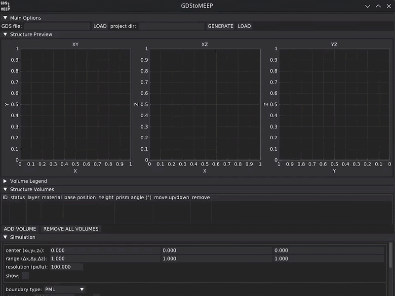

# GDStoMEEP
**App with GUI for creating MEEP structures and simulations from GDS files.** 
  


## About 
<sup> Can we make free photonics simulation process stress-free and smooth?<strong>NO! (ó﹏ò｡)</strong> ...but we try anyway. ⚡︎</sup>

This project was created for one sole purpose: making simulating photonics for free more bearable.

As of today, there is no free tool that allows students to easily design and simulate anisotropic structures. Alternatives such as MEEP often come with poor documentation, making the learning curve steep. Moreover, the visualization of the structure is almost nonexistent. Some newer tools exist, but they come with limited functionality, such as a lack of waveguide tapering or anisotropy support.

**With this app, you can design your structure in a responsive GUI, set the simulation conditions, and automatically generate MEEP code to run the simulation.**

I've designed the app to make it easy to switch solvers if a reliable, faster alternative to MEEP becomes available ([FDTDX](https://github.com/ymahlau/fdtdx), I believe in you and will wait). I also hope that automatically generated comments will make your experience with MEEP more smooth. I hope that it can you some hours of debugging, the app patches some functionless that are not fixed in MEEP as for today (tapering, reading from gds).

**Current situation:** Want to simulate photonics for free? You can have slow or unstable. Or both. And no documentation.

| Tool | Solver | Free | HW accel. | Grating opt. | Vis. | Anisotropy |
|---|---|:---:|:---------:|:---:|:---:|:---:|
| Lumerical | FDTD, FEEM, FDE | ❌ |     ✅     | ✅ | ✅ | ✅ |
| Tidy3D | FDTD, FDE | ❌ |     ✅     | ✅ | ✅ | ✅ |
| GDSFactory+ | FDTD, FEEM | ❌ |     🟡*     | 🟡* | 🟡 | ✅ |
| MEEP | FDTD, FDE** | ✅ |    🟡     | ❌ | 🟡 | ✅ |
| FDTDX | FDTD | ✅ |     ✅     | ❌ | 🟡 | ❌ |
| COMSOL | FEEM | ❌ |     ✅     | ✅ | ✅ | ✅ |
| Gyptis | FEEM | ✅ |     ❌     | ❌ | ✅ | ✅ |

\* GDSFactory+ is a wrapper for Lumerical, MEEP, and Tidy3D APIs and is limited by the chosen solver.

\** Through MPB.


## How To Use
### Running the app
After installation simply run app.py from app directory. 

### GDS file preparation
The application works best for .gds files where different layers of 3D MEEP structure correspond to Layers in the file. You can assign multiple 3D layers to one .gds layer. Objects within layer should be flattened (see examples). Current version does not support additional options like reading data from ports or transferring units.
After successfully reading .gds file, you will be able to preview it on XY plot. 


I recommend integrating your setup with [Klayout](https://www.klayout.de/), which is an easy way to view and modify designs. 
### Cross-section design
You can design consecration of the structure in 'Structure Volumes' menu, and preview it on plots above. You can choose it's location 
by choosing the base level (Z-coordinate of the basis of the layer) and it's height (how thick the layer is). All units (if not otherwise stated in the interface) are local units (lu), meaning they are defined relatively to source.


With 'Simulation' menu you can add more MEEP objects, such as source and simulation area, for more detailed description see section 'Interface'.


When you are ready to generate the code, enter path to the location in which it should be stored and click 'GENERATE'. You can use 'LOAD' option in case you would like to modify your design (this function is based on generated metadata.txt and gds_file.gds files, changing them might cause errors; materials are still read from the original file, materials.py is copied for user convenience).


When running simulation for the first time please read the comments in script_fdtd.py file. To keep the interface simple I set some options to typically sufficient values, but you might consider changing them to satisfy your requirements.
### Adding new materials
To add new material please modify materials.py file, by appending a custom function. 


## Interface


## Installation

### Conda
The app is currently available only via Conda package manager.
#### OS limitations

The current version of the application has been tested on the following operating systems:
- TUXEDO OS 24.04 (based on Ubuntu 24.04), running KDE Plasma on Wayland.

GUI behavior may vary depending on the operating system, desktop environment, display server (Wayland/X11), display scaling, and window management settings.

Please note that according to MEEP documentation, running the simulations on Windows is only possible via Ubuntu terminal app and Scheme interface built from source.
#### Prerequisites
Please install the following:
- [Git](https://git-scm.com/) 
- [Conda](https://docs.conda.io/projects/conda/en/latest/user-guide/install/index.html)
#### Setup

1. Clone the repository:
   ```bash
   git clone https://github.com/SaLukasik/GDStoMEEP.git
   cd GDStoMEEP
   
2. Create, activate, and test the Conda environment (you can choose a different name):
   ```bash
   conda env create -f environment.yml -n gds-to-meep
   conda activate gds-to-meep
   python -c "import meep; print('Meep OK', meep.__version__)"

3. In case of using IDE you might need to change the interpreter in settings, for example in PyCharm 2025.3.6.1. go to Edit -> Settings -> Python -> Interpreter -> Add local interpreter -> options 'Select Exisitng', 'Conda', and path to your installation.

## AI Usage Disclosure

AI-based tools were used during the development of this project to assist with selected tasks, such as code development, debugging, and documentation.
Code written completely by AI has been marked with model name written after hash series.


## TODO wishlist
0. Automatic comprehensive testing.
1. Add toggles for turning on/off comment generation, structure/state saving and plotting.
2. Add option of mode solver code generation. 
3. Make available through Docker?
4. Testing on other setups.
5. Add symmetry support.
6. Add uniform axis scaling option in GUI.